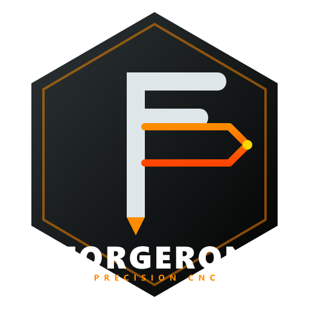

# Forgeron — Contrôleur CNC 5-Axes Industriel

<p align="center">
  
</p>

**Forgeron** est une application Flutter de grade industriel conçue pour le pilotage haute performance de machines CNC 5-axes (configuration Trunnion X,Y,Z,A,C). Optimisée pour le firmware **FluidNC v3.7+**, elle garantit un usinage sans saccades et une sécurité matérielle accrue.

## 🔌 Connexion à l'ESP32 FluidNC

### Protocole WebSocket
- **URL** : `ws://<IP_ESP32>:80/` (port 80, slash final obligatoire)
- **Format** : FluidNC envoie des **frames binaires WebSocket** (pas du texte) → décodage UTF-8 automatique dans l'application
- **Heartbeat** : commande `?` toutes les 2s, timeout déconnexion à 10s

### Découverte automatique
1. Aller dans **Connexion** → cliquer **SCANNER**
2. L'application scanne le sous-réseau local (priorité aux IPs .200, .100, .1...)
3. Cliquer **CONNECTER** sur le device trouvé
4. L'état passe à **EN LIGNE** avec l'IP affichée dans la barre du haut

### Configuration manuelle
- Entrer l'IP manuellement dans le champ **Adresse IP**
- Port par défaut : **80**
- URL WebSocket calculée automatiquement : `ws://IP:80/`

---

## 🚀 Fonctionnalités

### 1. Contrôle machine temps réel
- **DRO Live** : X, Y, Z, A, C mis à jour depuis les status reports FluidNC `<Idle|MPos:...>`
- **JOG 5 axes** : boutons X±/Y±/Z± et A±/C± avec pas configurable (0.001 → 100mm)
- **Commandes temps réel** : STOP jog (`0x85`), PAUSE (`!`), REPRISE (`~`), RESET (`Ctrl-X`)
- **Alarme** : déverrouillage automatique via `$X` avant les commandes critiques

### 2. Macros multi-lignes
Les macros G-Code multi-lignes sont envoyées ligne par ligne avec 200ms d'intervalle :
- PALPAGE CENTRE A, CHANGEMENT OUTIL, NETTOYAGE PLATEAU, WARMUP BROCHE

### 3. WCS (Systèmes de coordonnées)
- Cliquer sur G54/G55/G56 dans l'onglet Palpage & Origines envoie la commande à la machine

### 4. Streaming G-Code
- **Character-Counting** : gestion du buffer RX (127 octets) pour streaming continu
- **Virtualisation UI** : ListView avec `itemExtent` fixe pour des fichiers de millions de lignes

### 5. Résilience réseau
- **Reconnexion Exponential Backoff** : 1s, 2s, 4s... plafonné à 30s
- **Heartbeat Watchdog** : `?` toutes les 2s, timeout à 10s (assez long pour les jogs)

### 6. Adaptateur G-code CAM & 5 axes
- **Adaptation automatique** au chargement : traduit le G-code SolidWorks CAM / Fanuc-ISO pour FluidNC (retire O/N/G28/G43/H, développe les cycles fixes G81/G82/G83, `M6`→pause `M0`).
- **Sécurité RTCP** : **bloque** le G-code en repère pièce que FluidNC (Cartesian) ne peut pas exécuter — Fanuc `G43.4/.5`, Siemens `TRAORI/TRANSMIT`, Heidenhain `M128/FUNCTION TCPM` — ainsi que la compensation de rayon machine `G41/G42`.
- **3+2 positionnel** validé sur machine ; **5 axes continu** via post en coordonnées machine (générateur de parcours dôme : `tool/gen_5axes_dome.dart`).
- **Aperçu 3D fidèle** : interpolation des arcs G2/G3 + reconstruction cinématique de la pointe d'outil dans le repère pièce.

### 7. Sécurité
- **Récupération d'alarme fiable** : `$X` lève l'alarme sans relancer le programme dans la butée (purge du streaming à l'entrée en ALARM).
- **Notifications** : alerte au dépassement de fin de course, sans rafale pendant le homing.
- **must_home** (optionnel) + **soft_limits** : refus d'exécuter un parcours hors-course.

---

## 🔧 Hardware Cible — Prototype PFE

| Composant | Référence |
|-----------|-----------|
| Contrôleur | ESP32 DevKit V1 (30 broches) |
| Firmware | FluidNC (testé sur **v4.0.3**) |
| Drivers moteur | 5× TB6600 (STEP/DIR) |
| Axes | X, Y, Z (linéaires) + A, C (rotatifs Trunnion) |
| **Alimentation moteurs** | **Alim ATX de bureautique HP** (Delta DPS-475CB-1 A, **12 V / ~38 A**) |
| Broche | Moteur DC **775** (12 V, 200 W, 15 000 tr/min) |

### Câblage GPIO ESP32 → TB6600

| Axe | STEP GPIO | DIR GPIO |
|-----|-----------|----------|
| X   | GPIO 26   | GPIO 27  |
| Y   | GPIO 25   | GPIO 33  |
| Z   | GPIO 32   | GPIO 23  |
| A   | GPIO 19   | GPIO 18  |
| C   | GPIO 17   | GPIO 16  |
| ENA (partagé ×5) | **GPIO 22** | — |

### Alimentation

L'alimentation des moteurs est une **alim ATX de bureautique HP** (Delta **DPS-475CB-1 A**, rail **12 V / ~38 A**), qui a **remplacé le chargeur PC 65 W** (3,33 A, trop faible → décrochage des moteurs et de la broche).

- **Démarrage** : c'est une alim propriétaire → relier **PS_ON (fil vert) → GND (noir)** pour l'allumer ; brochage propriétaire, prendre le 12 V sur les connecteurs **Molex/SATA** (jaune = +12 V, noir = GND).
- **⚠️ Fusible** en série sur le 12 V (obligatoire — l'alim peut débiter 38 A sans limite).

### Fins de course, E-STOP & broche

| Fonction | GPIO | Câblage / config |
|----------|------|------------------|
| Fin de course X | GPIO 4  | switch **NC** → GND, pull-up (`gpio.4:high:pu`) — **fail-safe** |
| Fin de course Y | GPIO 13 | switch **NC** → GND (`gpio.13:high:pu`) |
| Fin de course Z | GPIO 14 | switch **NC** → GND (`gpio.14:high:pu`) |
| Fin de course / homing **A** | GPIO 5 | switch **NC** → GND (`gpio.5:high:pu`) ; capteur à **-88°** → A=0 = horizontale |
| **ARRÊT D'URGENCE** | GPIO 15 | bouton **NF** → GND, pull-up interne (`estop_pin: gpio.15:high:pu`) — fail-safe, sans résistance externe |
| Broche DC | GPIO 21 | module relais tout-ou-rien (`Relay: output_pin`). `M3`=ON, `M5`=OFF |

> **Fins de course en NC (fail-safe)** : un fil coupé/débranché déclenche une **alarme** au lieu de désactiver la sécurité en silence. `hard_limits` **réactivés** (les faux déclenchements venaient du bruit, réglé par un **câblage propre en coffret** — fils capteurs séparés des fils moteurs).
>
> **Broche** : le relais 10 A est **sous-dimensionné** pour le 775 (~17 A) → migration prévue vers un **MOSFET logic-level (IRLB8721) + diode de roue libre + fusible** (commande on/off + vitesse PWM). E-STOP à téléverser **seulement une fois le bouton câblé** (sinon ALARM:11).

**Config FluidNC** : `scratch/config_5axes_production.yaml`

---

## 📦 Installation & Lancement

```bash
flutter pub get
flutter run -d windows    # Application bureau Windows
```

> ⚠️ Le message "Nuget is not installed" lors du build Windows est bénin et n'empêche pas la compilation.

---

## 📁 Structure du projet

```
lib/
├── application/
│   ├── providers/          # Riverpod providers (machine, jog, gcode...)
│   └── services/           # Auto-découverte mDNS/HTTP
├── data/
│   ├── fluidnc/            # Connexion WebSocket + parser GRBL
│   └── mock/               # Repository simulation (mode hors connexion)
├── domain/
│   ├── models/             # MachineState, JogCommand, Macro...
│   └── repositories/       # Interface MachineRepository
└── presentation/
    ├── screens/            # Dashboard, Palpage, Terminal MDI...
    └── widgets/            # Visualiseur 3D Trunnion, GlassPanel...

scratch/
├── config_5axes.yaml            # Config FluidNC test (null_motor)
├── config_5axes_production.yaml # Config FluidNC production (TB6600 réel)
├── current_config.yaml          # Sauvegarde config originale ESP32
└── demo_dome_5axes_continu.nc   # Parcours 5 axes continu de démo (air-cut)

tool/
├── gen_5axes_dome.dart          # Générateur de parcours 5 axes continu (dôme)
└── scale_gcode.dart             # Mise à l'échelle des dimensions d'un G-code

DOCS_5axes_continu_post_CAM.md   # Guide de config du post SolidWorks CAM (coords machine)
README_FEUILLE_DE_ROUTE_V2.md    # Cahier des charges détaillé des évolutions v2 (Multilingue, Démo, UI, Temps réel ESP32)
```

---

## 🗺️ Feuille de Route & Spécification Détaillée des Évolutions (v2)

> 📄 **Spécification complète et architecture détaillée** : voir **[`README_FEUILLE_DE_ROUTE_V2.md`](./README_FEUILLE_DE_ROUTE_V2.md)**.

### Axe 1 — Résolution des défaillances multilingues en mode local (Langue de l'Agent IA & Affichage UI)
- **Diagnostic** :
  - En mode local (`forgeron-qwen` / `qwen2.5:7b` sous Ollama), le garde-fou `driftedToChinese` (`lib/application/services/local_ai_agent_service.dart`) ne détecte que les caractères chinois (CJK) et laisse passer la dérive vers l'**anglais** après l'exécution d'un outil renvoyant du JSON technique (reproduit dans `scratch/test_lang.py`).
  - La directive de langue est noyée au milieu du prompt système (`_buildSystemPrompt` dans `ai_agent_provider.dart`) et le mode `auto` échoue après un message `role: 'tool'`.
  - Plusieurs écrans (`AiConsoleScreen`, `tutorial_data.dart`, `grbl_alarm_catalog.dart`, `app_settings_screen.dart`) contiennent du texte français codé en dur hors `tr()`, le Bambara (`bm`) est absent de `kAppTranslations`, et les widgets `const` de `MainScaffold` ne se reconstruisent pas instantanément au changement de langue.
- **Tâches planifiées** :
  - **`T1.1`** : Découplage `uiLanguageProvider` (langue d'affichage de l'interface) et `aiLanguageProvider` (langue de l'Agent IA et de la voix).
  - **`T1.2`** : Détection déterministe côté Dart (`LanguageDetector`), **Sandwich Prompting** (début + fin du prompt système) et rappel impératif de langue injecté après chaque retour d'outil (`role: 'tool'`).
  - **`T1.3`** : Garde-fou `driftedToWrongLanguage` détectant à la fois le CJK et la dérive vers l'anglais lorsque la langue cible est le français (ou une autre langue), avec réécriture automatique contrainte.
  - **`T1.4`** : Architecture hybride sécurisée (Pivot déterministe + Lexique gouverné `ai_lexicon_front.dart`) pour les langues locales à faibles ressources (`bm`, `am`, `om`, `ti`, `wo`, `sw`, `ha`, `yo`, etc.).
  - **`T1.5` & `T1.6`** : Reconstruction réactive immédiate de toute l'interface (`ValueKey(uiLang.code)` + `AiSubWindowApp`), extraction de 100 % des chaînes codées en dur vers `tr()`, et création du dictionnaire `lib/core/i18n/translations/bm.dart`.

### Axe 2 — Mode Démo Multimédia (« Prises en main » Images + Vidéos), Banc d'Essai STEP (Manufacturing & Médecine), Agent « Mémoire du Contrôleur », Chatbot Omniprésent & Suggestions Proactives
- **Tâches planifiées** :
  - **`T2.1` — Prises en main multimédias (Images + Vidéos)** : Présentation interactive de chaque fonctionnalité par l'Agent IA avec cartes visuelles annotées, capsules vidéo de prise en main (`FeatureHandsOnCard`) et narration vocale.
  - **`T2.2` — Banc d'essai guidé en 1 clic avec les fichiers STEP embarqués** :
    - **Filière Manufacturing** : Turbine 5 axes (`scratch/3D/IMPELLER.STP` + `IMPELLER.nc`), Vis d'Archimède (`scratch/3D/small-archimedes-impeller-1.snapshot.7/Small Archimedes impeller.STEP`), Dôme 5 axes continu (`scratch/demo_dome_5axes_continu.nc`).
    - **Filière Médecine** : Implant crânien sur-mesure (`scratch/3D/patient-specific-cranial-implant-1.snapshot.3/rend.step` + `rend_implant5.nc`), Arcade dentaire maxillaire (`scratch/3D/Maxillary_teeth_w_base_NIH3D.stl`), Prothèse dentaire dentine/émail (`scratch/3D/wk-blase-edit-schmelz-dicht-Dentin.stl`).
  - **`T2.3` — L'Agent comme « Mémoire Totale du Contrôleur » (`ControllerMemoryStore`)** : Centralisation temps réel de l'état machine 5 axes, du câblage GPIO ESP32, de l'historique de santé/reboots, du programme STEP/G-code actif et du journal des 50 dernières opérations opérateur.
  - **`T2.4` — Chatbot Omniprésent Multi-Ancrage (`OmnipresentAiShell`)** : Accessible depuis **n'importe quelle fenêtre** sans masquer le travail en cours, commutable à la volée en **Flottant (HUD déplaçable)**, **Ancré en Bas (tiroir horizontal / feuille coulissante)** ou **Ancré à Droite (panneau latéral split-view)**.
  - **`T2.5` — Suggestions Dynamiques Post-Opération (`NextBestActionEngine`)** : Génération automatique de 3 à 4 nouvelles suggestions d'orientation après chaque opération (connexion, homing, palpage, import STEP, génération G-code, alarme ou dépannage).

### Axe 3 — Professionnalisation de l'Interface (Mobile à part & Desktop à part) : Animations & Ergonomie Industrielle
- **Tâches planifiées** :
  - **`T3.1` — Cockpit Desktop Multi-Panes** : Ruban supérieur permanent de télémétrie & sécurité (mini-DRO 5 axes, santé ESP32, `E-STOP` global, sélecteur de langue), harmonisation du thème industriel `ForgeTheme`, panneaux latéraux redimensionnables et raccourcis clavier d'atelier (`F1`, `F2`, `Espace`, `Ctrl+X`, `Échap`).
  - **`T3.2` — Pendant Mobile Une Main** : Bandeau DRO supérieur toujours visible, tiroir IA coulissant multi-crans (`15% / 45% / 85%`) ne masquant jamais l'arrêt d'urgence, cibles tactiles haute sécurité et retours haptiques différenciés.
  - **`T3.3` — Animations Haute Précision (60 FPS)** : Interpolation cinématique fluide des 5 axes (X, Y, Z, A, C) dans le visualiseur 3D Trunnion et halos visuels synchronisés avec la télémétrie et les alertes.

### Axe 4 — Interprétation Temps Réel des Codes Alarme & des Redémarrages de la Carte ESP32 depuis N'importe Quelle Fenêtre
- **Diagnostic** :
  - Actuellement, `CriticalEventWatcher._askAi()` (`lib/application/providers/critical_event_provider.dart`) exige une clé API Cloud Gemini et ignore totalement `LocalAiAgentService` (Ollama) en mode local.
  - Aucun détecteur n'identifie les redémarrages intempestifs de la carte ESP32 (bannières de boot `Grbl 3.x [FluidNC...]`, `rst:0x...`, `Brownout detector`, ou perte soudaine du Homing vers `ALARM:15` / `MPos:0,0,0` après micro-coupure).
- **Tâches planifiées** :
  - **`T4.1` — Détecteur Temps Réel `Esp32RebootDetector`** : Analyse des signatures de boot/reset dans `GrblParser` et détection heuristique de perte d'état machine à la reconnexion WebSocket.
  - **`T4.2` — Corrélateur de Cause Matérielle (`HardwareRootCauseCorrelator`)** : Croisement automatique avec la mémoire du contrôleur (ex. reboot `< 3 s` après `M3` = chute de tension/brownout liée à l'appel de courant ~17 A de la broche 775 sur GPIO 21 ; dérive après `> 20 min` = surchauffe thermique TB6600/ESP32 ; `ALARM:1/11` = identification exacte du capteur NC ouvert via `Pn:XYZAE`).
  - **`T4.3` — Connexion de `CriticalEventWatcher` à `LocalAiAgentService`** : Prise en charge native du modèle local `forgeron-qwen` hors-ligne pour le diagnostic temps réel dans la langue de l'opérateur.
  - **`T4.4` — Alerte Omniprésente & Remédiation en 1 Clic** : Ouverture automatique du Chatbot sur n'importe quelle fenêtre dès qu'une alarme ou un reboot ESP32 survient, avec boutons d'action directs (`Déverrouiller $X`, `Relancer Homing $H`, `Tester capteur GPIO`, `Reprendre à la ligne N`).

---
*Projet de Fin d'Études (PFE) — ENI — Configuration Trunnion 5-Axes.*
