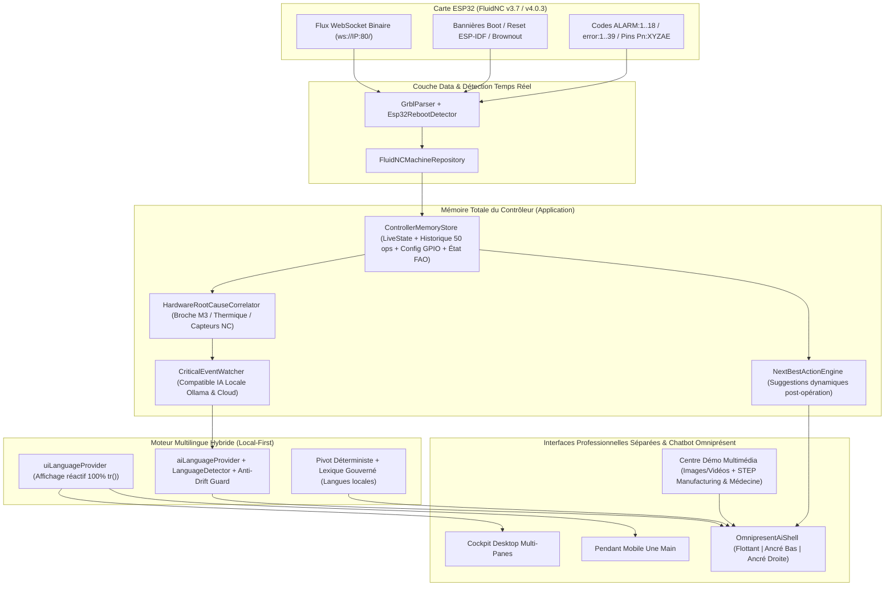
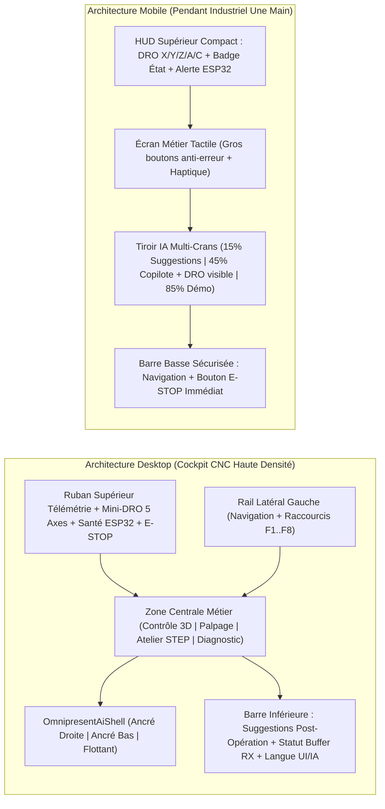
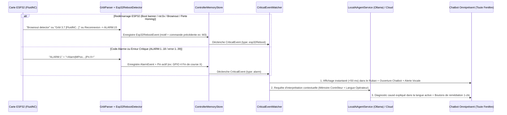

# Forgeron v2 — Cahier des Charges & Feuille de Route d'Architecture

> **Statut du document** : Spécification technique détaillée préalable à l'implémentation.  
> **Périmètre** :
> 1. Correction des défaillances multilingues en mode local (Langue de l'Agent IA & Langue d'affichage UI).
> 2. Mode Démo multimédia (« Prises en main » images + vidéos), essais guidés avec fichiers STEP embarqués (**Manufacturing** & **Médecine**), Agent IA comme **Mémoire du Contrôleur**, **Chatbot omniprésent** (flottant / bas / droite) et **suggestions proactives** après chaque opération.
> 3. Professionnalisation séparée des interfaces **Mobile** et **Desktop** (ergonomie industrielle & animations haute précision).
> 4. Interprétation temps réel par l'Agent IA des **codes alarme GRBL/FluidNC** et des **redémarrages (reboots/brownouts) de la carte ESP32** depuis n'importe quelle fenêtre.

---

## Vue d'ensemble de l'architecture cible



---

## Axe 1 — Résolution des défaillances multilingues en local (Langue de l'Agent IA & Affichage UI)

### 1.1 Diagnostic technique des défaillances actuelles

#### A. Pourquoi l'Agent IA local (`forgeron-qwen` / `qwen2.5:7b` sous Ollama) dérive vers l'anglais ou le chinois ?
L'analyse du code et le script de reproduction `scratch/test_lang.py` mettent en évidence **5 causes racines** :

1. **Garde-fou anti-dérive limité aux caractères chinois (CJK)** :
   - Dans `lib/application/services/local_ai_agent_service.dart` (`driftedToChinese`, lignes 639–654), le service vérifie uniquement la présence d'idéogrammes CJK (`\u4E00-\u9FFF`).
   - Comme le montre `scratch/test_lang.py`, lorsque l'opérateur pose une question en français (*« Charge ce fichier STEP et prépare le G-code de finition... »*), `forgeron-qwen` appelle l'outil `run_step_pipeline`, reçoit un résultat JSON contenant des clés techniques en anglais (`status`, `error`, `nc_path`), puis **répond en anglais** (*« I encountered an error while attempting to generate the G-code... »*) sans que le garde-fou ne se déclenche.
2. **Dilution de la consigne de langue (« Lost in the Middle »)** :
   - Dans `lib/application/providers/ai_agent_provider.dart` (`_buildSystemPrompt`, lignes 1093–1107), la directive `lang.promptDirective` est placée au milieu du prompt système, **avant** le bloc `liveStateBlock` (~1 500 tokens), la documentation `DOCS.md` et le journal d'activité. Après l'injection d'une réponse d'outil (`role: 'tool'`), un modèle 7B local perd l'instruction de langue initiale.
3. **Défaillance du mode `auto` après un appel d'outil** :
   - Dans `lib/core/i18n/app_language.dart` (`promptDirective`, lignes 66–71), le mode `auto` demande au modèle : *« Réponds TOUJOURS dans la langue du dernier message de l'opérateur »*. Or, lors du second appel d'inférence suivant l'exécution d'un outil, le dernier message de la liste `messages` est le message `role: 'tool'` (JSON en anglais), ce qui induit le modèle 7B en erreur.
4. **Risque de sécurité sur les langues africaines à faibles ressources en génération libre** :
   - Dans `lib/core/i18n/app_language.dart` (`kAppLanguages`, lignes 99–176), seul le Bambara (`bm`) a `writesPoorly: true`. Les autres langues locales (`sw`, `ha`, `yo`, `am`, `om`, `so`, `ti`, `wo`, `ff`, `ln`, `rw`, `zu`, `xh`, `ig`, `tw`, `sn`, `mg`) ont `writesPoorly: false`, alors que l'étude `docs/addis/05-etude-comparative-langues-locales.md` démontre que `qwen2.5:7b` produit des hallucinations dangereuses en génération libre directe dans ces langues.
5. **Couplage rigide entre langue d'affichage UI et langue de l'Agent IA** :
   - Un unique `appLanguageProvider` (`lib/core/i18n/app_language.dart`, ligne 186) impose la même langue à l'interface graphique et au copilote IA.

#### B. Pourquoi la langue d'affichage de l'interface (UI) présente des incohérences ?
1. **Chaînes codées en dur en français hors `tr()`** :
   - `lib/presentation/screens/desktop/ai_console_screen.dart` : 0 appel à `tr()` sur plus de 2 100 lignes.
   - `lib/presentation/tutorial/tutorial_data.dart` : les 36 étapes des 7 chapitres de prise en main sont codées en dur en français.
   - `lib/core/utils/grbl_alarm_catalog.dart` : les 18 codes `ALARM:1..18` et les 39 codes `error:1..39` sont codés en dur en français.
   - `lib/presentation/screens/app_settings_screen.dart` : plusieurs libellés de configuration IA locale, Ollama et passerelle vocale sont codés en dur.
2. **Absence de reconstruction réactive lors du changement de langue** :
   - `tr()` (`lib/core/i18n/app_localizations.dart`, ligne 42) lit un champ statique `AppLocalizations.current` sans abonnement au `BuildContext`.
   - Dans `lib/presentation/screens/main_scaffold.dart` (lignes 117–125), la liste `_screens` instancie les écrans avec `const`, ce qui bloque leur reconstruction immédiate lors d'un changement de langue.
3. **Fenêtre secondaire Desktop non localisée** :
   - `AiSubWindowApp` (`lib/main.dart`, lignes 39–55) ne configure ni `locale`, ni `localizationsDelegates`, ni `supportedLocales`.
4. **Dictionnaire Bambara (`bm`) manquant dans `kAppTranslations`** :
   - Le code `bm` est listé dans `kAppLanguages` (`app_language.dart`, ligne 118) mais absent de `lib/core/i18n/translations/translations.dart`, provoquant un repli silencieux vers le français.

---

### 1.2 Plan d'action détaillé — Axe 1 (Tâches `T1.1` à `T1.6`)

| ID | Tâche | Fichiers impactés | Détails d'implémentation |
|---|---|---|---|
| **T1.1** | **Découplage Langue UI / Langue Agent IA** | `lib/core/i18n/app_language.dart`<br>`lib/presentation/screens/app_settings_screen.dart` | Créer deux providers distincts persistés dans `SharedPreferences` :<br>1. `uiLanguageProvider` : langue d'affichage des écrans, menus et boutons.<br>2. `aiLanguageProvider` : langue de conversation et de synthèse vocale de l'Agent IA (avec option par défaut `match_ui` « Identique à l'interface » ou sélection explicite). |
| **T1.2** | **Résolution déterministe de la langue & Sandwich Prompting pour le LLM local** | `lib/core/i18n/language_detector.dart` *(nouveau)*<br>`lib/application/providers/ai_agent_provider.dart`<br>`lib/application/services/local_ai_agent_service.dart` | 1. Si `aiLanguageProvider == auto`, analyser le texte de l'opérateur côté Dart (`LanguageDetector.detect(userText)`) avant l'appel LLM pour obtenir un code ISO déterministe (`fr`, `en`, `es`, `ar`, etc.), en utilisant `uiLanguageProvider` comme repli.<br>2. **Sandwich Prompting** : placer la consigne de langue au tout début **et** en dernière ligne du prompt système.<br>3. **Ancrage Post-Outil** : après chaque message `role: 'tool'` envoyé à Ollama, annexer une instruction système finale : `[RAPPEL IMPÉRATIF DE LANGUE : Réponds à l'opérateur EXCLUSIVEMENT en <NomLangue> (<code ISO>). Ne réponds JAMAIS en anglais si la langue cible est le français.]` |
| **T1.3** | **Garde-fou Anti-Dérive Multilingue (`driftedToWrongLanguage`)** | `lib/application/services/local_ai_agent_service.dart` | Remplacer `driftedToChinese` par `driftedToWrongLanguage(String text, String targetLangCode)` :<br>- Conserver la détection CJK (`containsCjk`) lorsque `targetLangCode != 'zh'`.<br>- Ajouter la détection de dérive vers l'anglais lorsque `targetLangCode` est `fr`, `es`, `pt`, `de`, `it`, `ar`, etc. (détection par ratio de stop-words anglais : `"I encountered"`, `"Here is"`, `"The machine"`, `"Please"`, `"error while"`, etc. hors blocs de code G-code).<br>- En cas de dérive détectée, déclencher automatiquement une passe de réécriture contrainte (`temperature: 0.0`) dans la langue cible avant affichage à l'opérateur. |
| **T1.4** | **Architecture Hybride Sécurisée (Pivot Déterministe + Lexique Gouverné)** | `lib/core/i18n/app_language.dart`<br>`lib/application/providers/ai_lexicon_front.dart`<br>`docs/lexique-gouvernance.md` | Pour les langues locales à faibles ressources sur LLM 7B (`bm`, `am`, `om`, `ti`, `wo`, `ff`, `sw`, `ha`, `yo`, `ln`, `rw`, `zu`, `xh`, `ig`, `tw`, `sn`, `mg`) :<br>- Activer un drapeau `requiresSafetyPivot: true`.<br>- Les alertes critiques (alarmes, E-STOP, collisions, reboots ESP32) utilisent les gabarits déterministes validés du lexique gouverné (`ai_lexicon_front.dart`) + passerelle de traduction locale/Addis, tandis que le LLM local raisonne en langue pivot (`fr` ou `en`) sans jamais improviser de termes de sécurité non vérifiés. |
| **T1.5** | **Réactivité instantanée de l'affichage UI (`tr()`)** | `lib/core/i18n/app_localizations.dart`<br>`lib/presentation/screens/main_scaffold.dart`<br>`lib/main.dart` | 1. Dans `MainScaffold`, retirer le mot-clé `const` sur la liste `_screens` et attacher un `KeyedSubtree(key: ValueKey(uiLang.code), ...)` pour forcer la reconstruction immédiate de toute l'arborescence au changement de langue.<br>2. Injecter `locale`, `localizationsDelegates` et `supportedLocales` dans `AiSubWindowApp` (`lib/main.dart`). |
| **T1.6** | **Internationalisation complète des textes codés en dur & Ajout `bm.dart`** | `lib/presentation/screens/desktop/ai_console_screen.dart`<br>`lib/presentation/tutorial/tutorial_data.dart`<br>`lib/core/utils/grbl_alarm_catalog.dart`<br>`lib/core/i18n/translations/bm.dart` *(nouveau)* | 1. Remplacer toutes les chaînes françaises en dur de `AiConsoleScreen`, `AppSettingsScreen`, `grbl_alarm_catalog.dart` et `tutorial_data.dart` par des clés `tr()`.<br>2. Créer `lib/core/i18n/translations/bm.dart` (Bambara) à partir du lexique gouverné (`docs/lexique-gouvernance.md`) et l'enregistrer dans `kAppTranslations`. |

---

## Axe 2 — Démo Multimédia (« Prises en main » Images + Vidéos), Banc d'Essai STEP (Manufacturing & Médecine), Agent « Mémoire du Contrôleur », Chatbot Omniprésent & Suggestions Post-Opération

### 2.1 Inventaire des fichiers CAO/STEP & G-Code déjà présents dans Forgeron pour la Démo

L'audit du dépôt révèle que Forgeron contient déjà des pièces de démonstration de niveau industriel et médical qu'il suffit de structurer dans un catalogue unifié :

| Filière | Fichier CAO / STEP embarqué | Fichiers FAO / G-Code / Rapports associés | Cas d'usage présenté par l'Agent en Démo |
|---|---|---|---|
| **Manufacturing (Industrie / Énergie)** | `scratch/3D/IMPELLER.STP` | `scratch/3D/IMPELLER.nc`<br>`scratch/3D/IMPELLER_apercu.json`<br>`scratch/3D/IMPELLER_rapport.json` | **Turbine / Roue à aubes 5 axes** : démonstration complète de l'import STEP, analyse topologique OCCT, détection des pales, génération de parcours 5 axes et simulation cinématique Trunnion (A/C). |
| **Manufacturing (Mécanique / Hydraulique)** | `scratch/3D/small-archimedes-impeller-1.snapshot.7/Small Archimedes impeller.STEP` | Pipeline STEP → G-Code (`StepPipelineService`) | **Vis d'Archimède hélicoïdale** : test temps réel du pipeline CAO/FAO embarqué (`step_vers_gcode.py`) avec choix du matériau et de la fraise hémisphérique. |
| **Manufacturing (Surfaçage 5-Axes Continu)** | Générateur `tool/gen_5axes_dome.dart` | `scratch/demo_dome_5axes_continu.nc`<br>`pipeline/dome5.nc` | **Dôme 5 axes simultané (X, Y, Z, A, C)** : démonstration du mouvement continu synchronisé des 5 axes en coordonnées machine (air-cut sécurisé). |
| **Médecine (Chirurgie Crânienne sur-mesure)** | `scratch/3D/patient-specific-cranial-implant-1.snapshot.3/rend.step` | `scratch/3D/patient-specific-cranial-implant-1.snapshot.3/rend_implant5.nc`<br>`rend_apercu.json`<br>`rend_rapport.json` | **Implant crânien patient-spécifique (STEP)** : usinage 5 axes de surfaces gauches anatomiques (PEEK / Titane grade médical), contrôle d'état de surface et vérification des limites d'inclinaison A/C. |
| **Médecine (Odontologie / CFAO Dentaire)** | `scratch/3D/Maxillary_teeth_w_base_NIH3D.stl`<br>`scratch/3D/wk-blase-edit-schmelz-dicht-Dentin.stl` | `scratch/3D/wk-blase-edit-schmelz-dicht-Schmelz.stl`<br>`Post.stl` | **Arcade maxillaire NIH 3D & Prothèse dentaire (Dentine / Émail)** : usinage haute précision multi-faces (3+2 et 5 axes) pour laboratoire dentaire. |

---

### 2.2 Plan d'action détaillé — Axe 2 (Tâches `T2.1` à `T2.5`)

#### `T2.1` — Mode Démo Interactif avec « Prises en main » Multimédia (Images + Vidéos + Narration IA)
- **Objectif** : Lors d'une démonstration ou d'une formation opérateur, l'Agent IA ne se contente plus d'afficher du texte : il présente chaque fonctionnalité de Forgeron avec un **support visuel animé (images annotées + capsules vidéo de prise en main)** et propose immédiatement de la tester en conditions réelles ou simulées.
- **Fichiers à créer / modifier** :
  - `lib/domain/models/feature_showcase.dart` *(nouveau)* : modèle décrivant chaque fonctionnalité clé avec :
    - `id`, `titleKey`, `summaryKey`, `agentPitchKey` (script parlé/écrit par l'agent).
    - `mediaItems` : liste de médias (`ShowcaseMedia(type: image | video | interactive3d, assetPath: ..., captionKey: ...)`).
    - `guidedTryActions` : boutons d'essai direct en 1 clic (ex. *« Tester avec l'implant crânien (STEP Médecine) »*, *« Tester avec la turbine (STEP Manufacturing) »*, *« Simuler une alarme fin de course »*).
  - `lib/presentation/widgets/demo/feature_handson_card.dart` *(nouveau)* : lecteur multimédia intégré au Chatbot et à la modale de prise en main (carrousel d'images haute définition, lecteur vidéo fluide en boucle courte type « GIF/MP4 de prise en main », indicateurs visuels sur l'interface).
  - `lib/presentation/tutorial/tutorial_data.dart` : enrichissement des 7 chapitres existants avec les références multimédias et les scénarios d'essai pilotés par l'Agent.

#### `T2.2` — Banc d'Essai Guidé en 1 Clic avec Fichiers STEP Embarqués (`Manufacturing` & `Médecine`)
- **Objectif** : Permettre à l'opérateur ou au démonstrateur de lancer depuis le Chatbot (ou le bouton **Démo**) un test complet de bout en bout sans chercher de fichier sur le disque.
- **Fichiers à créer / modifier** :
  - `lib/domain/models/demo_benchmark_catalog.dart` *(nouveau)* : registre structuré des cas d'essai embarqués (`Manufacturing` : `IMPELLER.STP`, `Small Archimedes impeller.STEP`, `demo_dome_5axes_continu.nc` ; `Médecine` : `rend.step` [Implant crânien], `Maxillary_teeth_w_base_NIH3D.stl`, `wk-blase-edit-schmelz-dicht-Dentin.stl`).
  - `lib/application/services/ai_agent_tools.dart` : ajout de 2 nouveaux outils appelables par l'Agent IA :
    1. `present_feature_handson(feature_id)` : ouvre la carte multimédia (image + vidéo de prise en main) de la fonctionnalité demandée et explique son fonctionnement.
    2. `run_demo_benchmark(domain: 'manufacturing' | 'medicine', sample_id: 'impeller' | 'cranial_implant' | 'archimedes' | 'dental_arch', mode: 'preview_fast' | 'full_pipeline')` :
       - Charge automatiquement le fichier STEP/STL et son rapport/G-code associé (en mode `preview_fast` instantané pour les démos fluides, ou en exécutant `StepPipelineService` en direct en mode `full_pipeline`).
       - Bascule ou synchronise le visualiseur 3D Trunnion avec le maillage CAO et le parcours d'outil 5 axes.
       - Publie dans le chat le bilan matière/outil/temps d'usinage et les prochaines actions suggérées.

#### `T2.3` — L'Agent IA comme « Mémoire Totale du Contrôleur » (`ControllerMemoryStore`)
- **Objectif** : Donner à l'Agent IA une connaissance exhaustive, structurée et persistante de tout ce qui se passe sur la machine et dans l'application afin qu'il puisse dépanner l'utilisateur depuis n'importe quelle fenêtre.
- **Fichiers à créer / modifier** :
  - `lib/application/providers/controller_memory_provider.dart` *(nouveau)* et extension de `lib/application/services/live_state_block.dart` :
    - **1. Mémoire Temps Réel Machine** : État GRBL (`status`), positions `MPos` / `WPos` (X, Y, Z, A, C), avances `F` et broche `S`, état des pins `Pn:` décodé broche par broche selon `scratch/config_5axes_production.yaml` (GPIO 4, 13, 14, 5, 15, 21, 22, etc.).
    - **2. Mémoire Santé Électronique & ESP32** : Compteur de redémarrages ESP32 de la session (`esp32RebootCount`), horodatage et motif du dernier reset (`lastResetReason`), durée de fonctionnement continu (`uptime`), historique des chutes de tension / déconnexions WebSocket, résultats des derniers tests de continuité (`ProbingScreen` / `ElectricalDiagnosticScreen`).
    - **3. Mémoire FAO & Usinage** : Fichier STEP/G-code actif, rapport d'adaptation `GCodeAdapter` (commandes remplacées, alertes RTCP `G43.4`/`TRAORI`, limites d'axes X/Y/Z/A/C du programme vs courses machine), numéro de ligne G-code en cours ou dernière ligne exécutée avant interruption.
    - **4. Mémoire Contextuelle UI & Journal des 50 dernières Opérations (`OperationRingBuffer`)** :
      - Fenêtre active (`activeTab` : Contrôle, Palpage, Atelier STEP, Diagnostic, Caméra/Reco3D, Terminal, Paramètres).
      - Journal horodaté des 50 derniers événements (commandes envoyées, boutons cliqués, outils IA exécutés, changements d'état, alarmes).

#### `T2.4` — Chatbot Omniprésent Multi-Ancrage (Flottant, en Bas ou à Droite) depuis N'importe Quelle Fenêtre
- **Objectif** : Rendre le copilote IA accessible **en permanence sur tous les écrans** (sans obliger l'utilisateur à quitter le Dashboard, le Palpage ou l'Atelier CAO pour aller dans l'onglet IA), avec 3 positions d'ancrage au choix.
- **Fichiers à créer / modifier** :
  - `lib/presentation/widgets/ai/omnipresent_ai_shell.dart` *(nouveau)* :
    - **Mode 1 — Ancré à Droite (`DockPosition.right`)** : Tiroir latéral droit redimensionnable (320 px à 480 px) affiché à côté de la fenêtre active. Idéal sur Desktop pour suivre les instructions de dépannage tout en manipulant le DRO, le Palpage ou le Diagnostic électrique.
    - **Mode 2 — Ancré en Bas (`DockPosition.bottom`)** : Console horizontale repliable en bas d'écran (hauteur réglable 180 px à 360 px sur Desktop ; feuille coulissante multi-crans `15% / 45% / 85%` sur Mobile).
    - **Mode 3 — Flottant (`DockPosition.floating`)** : Fenêtre « Picture-in-Picture » déplaçable librement avec effet `GlassPanel`, mode compact (barre d'état + 1 ligne + micro + suggestions) ou mode étendu.
  - Intégration directe dans `lib/presentation/screens/main_scaffold.dart` pour encapsuler l'ensemble des écrans Desktop et Mobile.

#### `T2.5` — Moteur de Suggestions Proactives Après Chaque Opération (`NextBestActionEngine`)
- **Objectif** : Orienter l'utilisateur étape par étape en générant **de nouvelles suggestions contextuelles après chaque opération** (et non uniquement lorsque le chat est vide).
- **Fichiers à créer / modifier** :
  - `lib/application/providers/contextual_suggestions_provider.dart` *(nouveau)* :
    - Écoute les transitions de `ControllerMemoryStore` (changement d'état machine, fin d'outil IA, changement d'onglet, chargement STEP/G-code, apparition/levée d'alarme, reboot ESP32).
    - Produit une liste dynamique de 3 à 4 `SuggestedActionChip` (icône, libellé traduit dans la langue active, prompt ou action directe associée).
  - **Matrice des suggestions post-opération** :

| Événement / Opération venant d'être réalisée | Nouvelles suggestions générées automatiquement par l'Agent |
|---|---|
| **Ouverture de l'application / Mode Démo** | 🎬 *Présentation guidée (Images & Vidéos)* · ⚙️ *Démo STEP Manufacturing (Turbine)* · 🏥 *Démo STEP Médecine (Implant crânien)* · 🔌 *Connecter la machine* |
| **Connexion WebSocket établie avec l'ESP32** | 🏠 *Lancer le Homing ($H)* · 🩺 *Vérifier les capteurs NC & E-STOP* · 📂 *Charger un modèle STEP de test* |
| **Homing ($H) terminé avec succès** | 📍 *Palper l'origine pièce (G54)* · 🧱 *Charger un fichier STEP/G-Code* · 🕹️ *Tester un déplacement Jog sécurisé* |
| **Fichier STEP chargé (`IMPELLER.STP` ou `rend.step`)** | 🛠️ *Générer le G-Code 5 axes* · 🔍 *Inspecter les dimensions & contre-dépouilles* · 👁️ *Voir la simulation 3D Trunnion* |
| **G-Code généré ou adapté** | ✈️ *Simuler à vide (Air-Cut Z+20mm)* · 📏 *Vérifier l'enveloppe de travail X/Y/Z/A/C* · ▶️ *Lancer l'usinage* |
| **Alarme déclenchée (`ALARM:1..18`) ou Reboot ESP32** | 🔧 *Diagnostic immédiat de la cause* · 🔓 *Déverrouiller ($X) et dégager l'axe* · ⚡ *Tester le câblage GPIO concerné* · 🔄 *Reprendre à la ligne interrompue* |

---

## Axe 3 — Professionnalisation de l'Interface (Mobile à part & Desktop à part) : Animations & Ergonomie Industrielle

### 3.1 Diagnostic ergonomique actuel
1. **Desktop** : Mélange de composants `Material` (Dashboard, Palpage) et `FluentUI` (`AiConsoleScreen`), absence de barre supérieure globale de télémétrie sur les onglets secondaires, et absence de panneau latéral IA persistant.
2. **Mobile** : Le bouton flottant IA ouvre une nouvelle route plein écran (`_AiAssistantPage` dans `main_scaffold.dart`, ligne 550) qui masque totalement le DRO et le bouton d'arrêt d'urgence pendant que l'opérateur consulte l'IA.

### 3.2 Plan d'action détaillé — Axe 3 (Tâches `T3.1` à `T3.4`)



| ID | Tâche | Fichiers impactés | Détails d'implémentation |
|---|---|---|---|
| **T3.1** | **Refonte Desktop : « Cockpit Industriel Multi-Panes »** | `lib/presentation/screens/main_scaffold.dart`<br>`lib/presentation/widgets/desktop/cnc_top_telemetry_ribbon.dart` *(nouveau)*<br>`lib/presentation/theme/forge_theme.dart` | 1. **Ruban Supérieur Permanent (`CncTopTelemetryRibbon`)** : visible depuis **toutes** les fenêtres (y compris Palpage, Atelier STEP, Paramètres). Affiche en temps réel : badge d'état machine (`IDLE`, `RUN`, `ALARM`), mini-DRO 5 axes (`X, Y, Z, A, C`), santé ESP32 (latence ms, icône alimentation/reboot), sélecteur rapide de langue (`UI` / `IA`), bouton **Démo Multimédia**, et bouton **ARRÊT D'URGENCE (`E-STOP`)**.<br>2. **Harmonisation visuelle** : remplacement des disparités `FluentUI`/`Material` par un design system industriel unifié (`ForgeTheme` : carbone `#0B0F17`, panneaux `GlassPanel` à bordures fines `#1E293B`, typographie tabulaire `JetBrains Mono` pour les cotes numériques).<br>3. **Raccourcis clavier d'atelier** : `F1` (Ouvrir/Replier Chatbot IA), `F2` (Lancer Démo), `Espace` (Pause Feed Hold `!`), `Ctrl+X` (Reset FluidNC), `Échap` (Arrêt d'urgence immédiat). |
| **T3.2** | **Refonte Mobile : « Pendant CNC Une Main »** | `lib/presentation/screens/main_scaffold.dart`<br>`lib/presentation/widgets/mobile/mobile_pendant_hud.dart` *(nouveau)* | 1. **Maintien permanent de la sécurité visuelle** : suppression de la navigation plein écran qui cachait la machine lors de l'ouverture du chat IA. Remplacement par un tiroir coulissant multi-crans (`DraggableScrollableSheet`) laissant toujours le mini-DRO en haut et le bouton `E-STOP` accessible en bas.<br>2. **Ergonomie tactile d'atelier** : cibles tactiles $\ge 52\text{ dp}$, retour haptique différencié (`HapticFeedback.selectionClick` sur les pas de jog, `heavyImpact` sur alarme/E-STOP), protection anti-fausse manipulation sur les commandes critiques. |
| **T3.3** | **Animations Industrielles & Jumeau Numérique Fluide** | `lib/presentation/widgets/trunnion_3d_preview.dart`<br>`lib/presentation/widgets/animated_telemetry_ring.dart` *(nouveau)* | 1. **Interpolation cinématique 60 FPS** : lissage des mouvements du berceau Trunnion (axes rotatifs `A` et `C`) et de la broche (`X, Y, Z`) entre deux trames WebSocket (2 Hz → 60 FPS par interpolation `Tween`).<br>2. **Feedback visuel d'état** : halo pulsant ambre lors d'un palpage ou d'une analyse IA, halo rouge synchronisé en cas d'alarme ou de reboot ESP32, animation fluide d'ouverture/changement d'ancrage (`AnimatedPositioned` / `AnimatedSize`) du Chatbot omniprésent. |

---

## Axe 4 — Interprétation Temps Réel des Codes Alarme & des Redémarrages de la Carte ESP32 depuis N'importe Quelle Fenêtre

### 4.1 Diagnostic technique des défaillances actuelles

1. **Bug bloquant en mode local dans `CriticalEventWatcher`** :
   - Dans `lib/application/providers/critical_event_provider.dart` (méthode `_askAi`, lignes 178–188), le code vérifie :
     ```dart
     final apiKey = await ref.read(aiSettingsProvider.notifier).readApiKey();
     if (apiKey == null || apiKey.isEmpty) return null;
     final service = AiAgentService(apiKey: apiKey, model: settings.model);
     ```
   - **Conséquence** : Lorsque Forgeron fonctionne en mode **Local (Ollama `forgeron-qwen`)**, aucune clé API Gemini n'est renseignée et `LocalAiAgentService` n'est jamais appelé. L'analyse IA temps réel des alarmes est donc **totalement inopérante en mode local** !
2. **Absence de détection des redémarrages (Reboots / Resets / Brownouts) de l'ESP32** :
   - Dans `lib/data/fluidnc/grbl_parser.dart` et `lib/data/fluidnc/fluidnc_machine_repository.dart`, les messages système émis par l'ESP32 lors d'un redémarrage (`Grbl 3.7 [FluidNC ...`, `[MSG:INFO: FluidNC v...]`, `rst:0x...`, `Brownout detector was triggered`, `Guru Meditation Error`) sont classés en simples `GrblUnknownMessage` ou `GrblStartupMessage` sans déclencher d'alerte critique.
   - Or, sur l'architecture matérielle cible (ESP32 DevKit V1 + 5× TB6600 + moteur broche DC 775 sur relais GPIO 21 + alim ATX 12V), un redémarrage de l'ESP32 en cours de session est un événement critique qui fait perdre la position machine (`MPos` remis à zéro ou `ALARM:15 Must Home`) et nécessite un diagnostic immédiat.

---

### 4.2 Plan d'action détaillé — Axe 4 (Tâches `T4.1` à `T4.5`)



| ID | Tâche | Fichiers impactés | Détails d'implémentation |
|---|---|---|---|
| **T4.1** | **Détection Temps Réel des Redémarrages ESP32 (`Esp32RebootDetector`)** | `lib/data/fluidnc/grbl_parser.dart`<br>`lib/data/fluidnc/fluidnc_machine_repository.dart`<br>`lib/domain/models/esp32_reboot_event.dart` *(nouveau)* | Détecter un redémarrage de la carte ESP32 selon **3 mécanismes complémentaires** :<br>1. **Signatures de boot FluidNC/GRBL en cours de session** : réception de `Grbl 3.x [FluidNC...]` ou `[MSG:INFO: FluidNC...]` alors qu'une session était déjà initialisée.<br>2. **Signatures matérielles ESP-IDF** : détection des motifs `rst:0x1` (Power-on), `rst:0xf` / `Brownout detector was triggered` (chute de tension alimentation), `rst:0x7` / `rst:0x8` / `WDT` (Watchdog timeout), `Guru Meditation Error` / `Panic` (crash firmware).<br>3. **Heuristique de perte d'état après micro-coupure WebSocket** : si la machine était en `Run`, `Jog` ou `isHomed == true`, et qu'après une reconnexion automatique WebSocket elle apparaît en `ALARM:15` (`Must Home`) ou avec `MPos == (0,0,0)` alors que sa dernière position connue était non nulle. |
| **T4.2** | **Corrélation Causale Matérielle (`HardwareRootCauseCorrelator`)** | `lib/application/services/hardware_root_cause_correlator.dart` *(nouveau)*<br>`lib/core/utils/grbl_alarm_catalog.dart` | Croiser automatiquement l'alarme ou le reboot ESP32 avec la **Mémoire du Contrôleur** (`ControllerMemoryStore`) :<br>- **Cas 1 : Reboot `< 3 s` après `M3` (Allumage broche 775 sur GPIO 21)** → Diagnostiquer un *Brownout / Appel de courant (~17 A)* du moteur 775 sur le relais 10 A provoquant un creux de tension sur le 5V de l'ESP32 (recommander de vérifier l'isolation de l'alim ATX 12V et le montage MOSFET + diode de roue libre).<br>- **Cas 2 : Reboot ou dérive après `> 20 min` d'usinage continu** → Diagnostiquer une *surchauffe thermique* (drivers TB6600 ou régulateur 3.3V ESP32) et proposer un cycle de refroidissement.<br>- **Cas 3 : `ALARM:1` (Hard Limit) ou `ALARM:11` (E-STOP)** → Lire le champ `Pn:` du dernier `<Alarm|...|Pn:...>` pour identifier précisément la broche GPIO en défaut (`X` → GPIO 4, `Y` → GPIO 13, `Z` → GPIO 14, `A` → GPIO 5, `E` → GPIO 15 en câblage NF fail-safe) et indiquer s'il s'agit d'une butée mécanique atteinte ou d'un fil capteur coupé/débranché. |
| **T4.3** | **Activation de l'Analyse Temps Réel sur l'Agent IA Local (`LocalAiAgentService`)** | `lib/application/providers/critical_event_provider.dart` | Corriger `CriticalEventWatcher._askAi()` :<br>- Lire `settings.backend` dans `aiSettingsProvider`.<br>- Si `settings.backend == AiBackend.local` (ou en repli si la clé Cloud est absente), appeler `LocalAiAgentService(baseUrl: settings.localBaseUrl, model: settings.localModel)` avec le `ControllerMemoryStore` complet et le verrouillage de langue de l'Axe 1.<br>- Conserver la réponse déterministe instantanée (< 50 ms) pendant que l'agent local rédige son explication enrichie (1 à 3 s). |
| **T4.4** | **Interception Globale & Ouverture Automatique dans le Chatbot Omniprésent** | `lib/presentation/widgets/ai/omnipresent_ai_shell.dart`<br>`lib/presentation/widgets/critical_event_overlay.dart` | Quelle que soit la fenêtre active (Palpage, Atelier STEP, Paramètres, Caméra, Dashboard) :<br>1. Le ruban supérieur passe en mode alerte (rouge pour `ALARM` / `Reboot ESP32`, ambre pour `error` / avertissement).<br>2. Le **Chatbot Omniprésent** s'ouvre automatiquement (dans son ancrage courant : droite, bas ou flottant), injecte la carte de diagnostic temps réel dans le fil de discussion afin d'en garder la trace dans l'historique, et énonce l'alerte par synthèse vocale.<br>3. L'Agent propose immédiatement des **puces d'action de dépannage en 1 clic** adaptées à l'événement : `[🔓 Déverrouiller ($X) & Dégager]`, `[🏠 Relancer Homing ($H)]`, `[🩺 Ouvrir Diagnostic GPIO]`, `[▶️ Reprendre à la ligne N]`. |

---

## Ordre d'exécution recommandé pour la phase d'implémentation

1. **Étape 1 (Fondations Multilingues — Axe 1)** : Découplage `uiLanguageProvider` / `aiLanguageProvider`, `LanguageDetector`, Sandwich Prompting + garde-fou `driftedToWrongLanguage` dans `LocalAiAgentService`, ajout de `bm.dart`, et internationalisation des fichiers codés en dur (`grbl_alarm_catalog.dart`, `tutorial_data.dart`, `ai_console_screen.dart`).
2. **Étape 2 (Mémoire du Contrôleur & Détection Temps Réel ESP32/Alarmes — Axes 2 & 4)** : Implémentation de `Esp32RebootDetector`, `ControllerMemoryStore`, `HardwareRootCauseCorrelator`, et correction de `CriticalEventWatcher` pour supporter `LocalAiAgentService` (Ollama).
3. **Étape 3 (Chatbot Omniprésent & Suggestions Post-Opération — Axe 2)** : Création de `OmnipresentAiShell` (ancrages Flottant / Bas / Droite) et de `NextBestActionEngine` (`contextualSuggestionsProvider`).
4. **Étape 4 (Mode Démo Multimédia & Catalogue STEP Manufacturing/Médecine — Axe 2)** : Intégration de `DemoBenchmarkCatalog` (`IMPELLER.STP`, `Small Archimedes impeller.STEP`, `rend.step` implant crânien, modèles dentaires) et des cartes multimédias (images + vidéos de prise en main).
5. **Étape 5 (Ergonomie & Animations Desktop / Mobile séparées — Axe 3)** : Ruban de télémétrie supérieur Desktop, tiroir multi-crans Mobile, et interpolations cinématiques 60 FPS.

