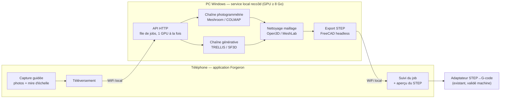

# De la photo au STEP — conception

*24 octobre 2026. Document de conception, **avant tout code**. Il décrit comment produire un fichier STEP à partir de photos, pour le remettre à l'adaptateur STEP→G-code déjà validé sur machine (3 axes et 3+2, essais à vide). Rien de ce qui suit n'est encore implémenté ; les versions des outils et les chiffres de performance seront **mesurés** au premier jalon, pas supposés ici.*

**Matériel de calcul retenu** : PC Windows avec GPU NVIDIA ≥ 8 Go de VRAM, sur le réseau local. **Les deux cas d'usage** sont visés (reproduire une pièce réelle *et* générer une forme depuis des images concept). Le téléphone se connecte directement au PC pour téléverser les images — pas de contrainte réseau, c'est déjà du tout-local.

---

## 0. Le problème, en une phrase

L'application sait déjà aller de **STEP → G-code**. Ce document ajoute l'amont manquant : **images → STEP**, pour fermer la chaîne *« je photographie une pièce (ou je dessine une forme) → je l'usine »*.

Le mobile reste le poste de l'opérateur ; le PC n'est qu'un **nœud de calcul** joignable sur le réseau local. On ne déplace pas l'application sur le PC : on déporte seulement le calcul lourd, comme pour l'agent IA.

---

## 1. Principe — le mobile capture, le PC calcule



**Pourquoi déporter.** Aucun de ces moteurs (Meshroom, TRELLIS, SF3D, FreeCAD) ne tourne sur Android : ni VRAM, ni CUDA, ni FreeCAD. Le téléphone fait trois choses seulement — capturer, suivre, afficher — et remet ensuite le STEP à l'adaptateur existant.

**Phase indépendante du pilotage.** La capture→STEP se fait pendant que le téléphone est sur le réseau du PC ; l'usinage se fait plus tard sur l'AP de l'ESP32. Les deux phases ne cohabitent pas : pas de conflit réseau à gérer.

---

## 2. Pile technique retenue

| Besoin | Moteur | Pourquoi ce choix |
|---|---|---|
| **Pièce réelle (métrique)** | **Meshroom** (AliceVision, CLI `meshroom_batch`) + CUDA | 100 % mesure, n'invente aucune géométrie cachée → conforme à *« jamais de données inventées »*. Repli scriptable : **COLMAP + OpenMVS**. |
| **Forme depuis images concept** | **TRELLIS** (Microsoft) en primaire · **SF3D** (Stability) en mode rapide | Modèle **IA génératif** obligatoire. TRELLIS = meilleure géométrie locale sur peu d'images ; SF3D quasi instantané pour les essais. Les deux tiennent dans 8 Go. **Interdit de substituer une méthode conventionnelle** (Visual Hull / découpe de silhouettes / Marching Cubes sur silhouettes) : c'est précisément ce qu'on ne veut pas. |
| **Nettoyage du maillage** | **Open3D** / **MeshLab** (CLI) | Décimation, bouchage de trous, lissage, suppression des îlots avant la CAO. |
| **Maillage → STEP** | **FreeCAD 1.0 headless** (`freecadcmd` + script Python) | *shape-from-mesh* → solide → export STEP, sans interface. |
| **Service** | **FastAPI** (Python) sur le PC | API HTTP, file de jobs, un seul job GPU à la fois. |

*Les numéros de version exacts sont épinglés au jalon 0 (Meshroom, FreeCAD, TRELLIS, pilotes CUDA) et consignés dans le dépôt du service.*

---

## 3. Les deux chaînes

### 3.1 Chaîne photogrammétrie — reproduire une pièce réelle

Entrée : 20 à 40 photos qui tournent autour de l'objet, recouvrement ≥ 60 %, lumière diffuse, fond neutre, **une mire d'échelle** dans le champ.

```
photos ─▶ Meshroom (SfM → MVS → maillage dense) ─▶ maillage texturé .obj
      ─▶ Open3D (décimation, trous, lissage) ─▶ maillage propre
      ─▶ FreeCAD headless (shape-from-mesh → solide) ─▶ .step
```

- **Métrique** : AliceVision cale l'échelle réelle à partir de marqueurs (ArUco/CCTag) ou d'un segment de longueur connue. Sans mire, le STEP est **sans cote** et marqué comme tel.
- **Fidèle** : pas de géométrie inventée ; ce qui n'a pas été vu reste un trou, signalé, jamais comblé d'office.

### 3.2 Chaîne générative — une forme depuis des images concept

Entrée : 1 à 4 images (croquis, photo d'inspiration).

```
images ─▶ TRELLIS (ou SF3D) ─▶ maillage .glb
       ─▶ Open3D (nettoyage) ─▶ FreeCAD headless ─▶ .step
```

- **Moteur = modèle IA uniquement** (TRELLIS en primaire, SF3D en repli rapide). **Aucune méthode conventionnelle de substitution** : ni Visual Hull, ni découpe de silhouettes, ni Marching Cubes sur silhouettes. Si le modèle IA n'est pas disponible, le mode concept est désactivé avec un message — on ne le remplace pas par du classique.
- **Rapide**, utile pour l'exploration de forme (usage forgeron : pièces organiques, ornements).
- **Forme inventée, sans échelle fiable** : la pièce est marquée **« forme approximative »**. L'opérateur fixe la cote réelle d'une arête dans Forgeron avant tout usinage. À ne pas utiliser pour une pièce fonctionnelle à cote.

> **Écart constaté le 25/10/2026.** La première implémentation (`tool/reco3d/reconstruct.py`, mode `gen`) utilise un **Visual Hull conventionnel** (silhouettes + Marching Cubes), **pas** un modèle IA. C'est contraire à la décision. **À remplacer par TRELLIS (primaire) / SF3D (repli).** Le mode `photo` (Meshroom, photogrammétrie métrique) est conservé tel quel : la pièce réelle à cote ne doit pas passer par un modèle IA qui invente la géométrie.

---

## 4. Trois points durs (à ne pas se cacher)

### 4.1 Le STEP sera *facetté*, pas paramétrique

Reconstruire une vraie B-rep propre (faces planes, cylindres, congés identifiés) **en automatique n'existe pas en open-source**. Ce qu'on produit est un **solide tessellé** : la peau triangulée emballée en volume. C'est du STEP valide, mais lourd (des milliers de facettes).

**Risque** : l'adaptateur STEP→G-code pourrait refuser ce STEP ou sortir des parcours démesurés. **C'est la seule vraie inconnue du projet.** → Jalon 0 (spike) la tranche avant tout code dans l'application. Si le STEP facetté ne passe pas, on ajoute un **chemin maillage → STL → CAM direct**, sans passer par STEP.

### 4.2 L'échelle (vital pour usiner)

Une photo n'a pas de cote. En photogrammétrie, **mire imprimée** (ArUco/ChArUco) ou réglet dans la scène → échelle réelle automatique. En génératif, **pas d'échelle** : Forgeron demande la cote réelle d'une arête et marque la pièce « approximative ».

### 4.3 Le métal brillant

Les pièces de forgeron réfléchissent : la photogrammétrie y troue le maillage. **Matifier avant de photographier** (spray/poudre développante, talc) ; lumière diffuse, pas de reflet spéculaire. À documenter dans l'écran de capture comme consigne, pas comme option.

---

## 5. Règles d'honnêteté (alignées sur l'application)

- **Rien d'inventé affiché comme mesuré** : une pièce générative porte le marquage « forme approximative » ; une reconstruction sans mire porte « sans échelle ». Un trou non reconstruit est signalé, jamais comblé en silence.
- **Chaque STEP porte sa provenance** : chaîne utilisée (photogrammétrie / génératif), moteur + version, présence d'une mire, facteur d'échelle, nombre de photos. Écrit à côté du fichier, visible dans Forgeron.
- **Les chiffres de qualité seront mesurés** (écart dimensionnel sur une pièce étalon, taux de trous), pas affirmés.

---

## 6. Service `reco3d` — contrat d'API (ébauche)

Dossier séparé (p. ex. `tools/reco3d/`), **brique modulaire** améliorable seule, comme les skills de l'agent.

| Route | Rôle |
|---|---|
| `POST /jobs` | photos (ou images) + mode (`photo`/`gen`) + référence d'échelle → identifiant de job |
| `GET /jobs/{id}` | état et progression (file → SfM → MVS → maillage → STEP) |
| `GET /jobs/{id}/result` | le STEP + sa fiche de provenance |
| `GET /health` | le service et le GPU sont prêts |

File d'attente : **un seul job GPU à la fois** (les reconstructions saturent la VRAM). Les jobs et leurs entrées sont conservés pour rejouer et comparer.

---

## 7. Intégration côté Forgeron (mobile)

- **Écran « Scan 3D »** : capture guidée (orbite, nombre de photos, consigne matifiant + mire), téléversement, barre de progression, aperçu du STEP, puis **remise à l'adaptateur STEP→G-code existant**.
- **Client Dart** de l'API `reco3d` (adresse du PC réglable, comme l'IP de l'ESP32).
- **Mode génératif** : étape obligatoire « fixer la cote réelle » + marquage « approximative ».

---

## 8. Plan par phases

| Phase | Contenu | Sortie | Touche l'app ? |
|---|---|---|---|
| **0 — Spike anti-risque** | Une pièce réelle → Meshroom manuel → OBJ → FreeCAD → STEP → **adaptateur existant**. Mesurer : le STEP passe-t-il ? taille des parcours ? Épingler les versions. | **Décision** : STEP facetté viable, ou chemin mesh→CAM à ajouter | Non |
| **1 — Service, chaîne photo** | `meshroom_batch` + nettoyage + `freecadcmd` export STEP + FastAPI + file + échelle par mire | Service `reco3d` photogrammétrie | Non |
| **2 — Chaîne générative** | TRELLIS/SF3D ajouté comme 2ᵉ mode (GLB → même sortie), marquage « approximative » | Service à deux modes | Non |
| **3 — Intégration Forgeron** | Écran de capture + client API + progression + remise à l'adaptateur | Chaîne mobile de bout en bout | Oui |
| **4 — Durcissement** | Validation d'échelle sur étalon, cache des jobs, gestion du métal brillant, tolérances | Preuves chiffrées | Oui |
| **5 — Scan en machine** | Caméras embarquées + rotation des axes A/C (tourne-table calibré) pour scanner un maître bridé, reconstruire en repère machine, puis usiner la repro. Voir §12. **Priorité : bring-up en simulation sur 1 ESP32 + 1 caméra ESP, sans câblage.** | Boucle de capture calibrée validée, puis gréement 5 caméras | Oui |

**On commence par la phase 0** : c'est rapide, ça ne touche pas l'application, et ça lève la seule vraie inconnue avant de construire dessus.

---

## 9. Critères d'acceptation

| Jalon | Critère |
|---|---|
| Phase 0 | Un STEP issu de photos est **ouvert et transformé en parcours** par l'adaptateur existant, OU l'échec est documenté et le chemin mesh→CAM décidé. Verdict écrit, avec la pièce test. |
| Phase 1 | Sur une pièce étalon avec mire : écart dimensionnel **mesuré** (mm) ; le STEP porte son facteur d'échelle. |
| Phase 3 | De bout en bout depuis le téléphone, sans ligne de commande, en moins de N minutes (N mesuré). |
| Phase 5.0 (sim) | Sur 1 ESP32 + 1 caméra ESP, sans câblage : N poses (A,C) planifiées → N vues étiquetées {cam, A, C} capturées par HTTP → job reco3d → `reconstruct.py` ingère le jeu. Provenance marquée « simulation ». Aucun moteur, aucune broche. |
| Toutes | Chaque STEP porte sa fiche de provenance ; aucune cote affichée comme sûre sans mire. |

---

## 10. Questions ouvertes

- **Meshroom CLI vs COLMAP+OpenMVS** : lequel donne le maillage le plus propre sur nos pièces (tranché au jalon 1 par mesure).
- **Tolérance de l'adaptateur au STEP facetté** : nombre de facettes acceptable avant explosion des parcours (jalon 0).
- **Mire** : format exact (ArUco seul, ou planche ChArUco), taille imprimée, procédure de pose.
- **Pièces fonctionnelles à cote serrée** : la chaîne facettée suffit-elle, ou faut-il une reprise manuelle de surfaces dans FreeCAD pour ces cas ? (à décider après le jalon 1, sur mesure réelle).

---

## 11. Verdict du Jalon 0 — Spike anti-risque (Mesuré le 24/10/2026)

Le spike prévu au §8 a été instrumenté et exécuté sur machine réelle via `tool/reco3d/measure_faceted_step.py` avec `pipeline/.venv312` (OpenCASCADE 8.0 / OCP) :

| Testé | Mesure réelle | Verdict |
|---|---|---|
| **Maillage direct (STL, 36 000 sommets)** | Extraction du profil en **0,18 s**, génération de **29 852 lignes G-code** via `mesh_profile` + `gen_revolution`. | **SUCCÈS IMMÉDIAT** : rapide, robuste, insensible aux facettes discrètes. |
| **STEP facetté (144 facettes planes)** | Taille : **312 Ko** (inflation ×44 p/r au STL équivalent). Lecture OpenCASCADE : 144 faces planes, 0 face analytique. | **REFUS CATÉGORIQUE** : `step_to_gcode` lève `ValueError` (« aucune face cylindrique/conique/sphérique/torique : pas de révolution détectable »). |

### Décision d'architecture arrêtée (Jalon 0 validé) :
1. **Flux interne Forgeron (fabrication) :** Le service `reco3d` transmet en priorité le **maillage nettoyé natif (STL/OBJ)** directement aux générateurs CAM (`mesh_profile` pour les révolutions, `dropcutter` / `gen_surface5` pour les formes libres).
2. **Export STEP :** Le fichier `.step` tessellé reste produit en sortie secondaire pour l'exportation vers des logiciels de CAO externes (FreeCAD, SolidWorks), mais **n'est pas le pivot du calcul machine**.

---

## 12. Phase 5 — Scan en machine (caméras embarquées + axes A/C)

Le maître à reproduire est **bridé sur la machine** ; on le scanne en tournant les axes **A et C** (et d'autres si besoin) **par angles connus**. L'idée est forte parce qu'elle règle d'un coup trois faiblesses :

1. **Angles connus** : chaque vue a une pose exacte (encodeurs de la machine) → **photogrammétrie multi-vues calibrée**, pas du freehand. C'est ce qui manquait au Visual Hull / aux photos téléphone (angles inconnus → géométrie fausse).
2. **Échelle** : la géométrie A/C + le montage caméra donnent une référence métrique.
3. **Repère machine** : scanner le maître *déjà bridé* reconstruit la forme **dans le repère machine** → le **zéro pièce se dérive**, au lieu d'être deviné.

> **Constat du 25/10/2026 (préalable à lever).** Le test de bout en bout a montré que le seul chemin maillage→G-code automatique est la **révolution** (`mesh_profile` + `gen_revolution`), qui **refuse les pièces scannées réelles** (3 essais, écarts 17–43 mm) ; `gen_surface5` prend une surface paramétrique et non un maillage, `dropcutter` n'a pas de pilote, et **rien ne relie un maillage scanné à un générateur 5 axes**. La Phase 5 suppose ce chaînon résolu (question ouverte §10.4). Aujourd'hui, aucune vérification X/Y/Z ni ajustement à l'enveloppe X80/Y150/Z110 ; seule la course de l'axe A est signalée, en commentaire.

### 12.1 Priorité — bring-up en SIMULATION (1 ESP32 + 1 caméra ESP, zéro câblage)

Objectif : valider la **boucle d'orchestration** sans machine réelle. **Aucun moteur, aucun driver, aucune broche.** Seulement un ESP32 sous FluidNC et une **ESP32-CAM sur le même AP** (cf. caméra existante, polling HTTP).

Boucle, pour chaque pose `(A, C)` du plan :
1. **Commander** le mouvement via WebSocket FluidNC.
2. **Lire** la position rapportée (`?` → `MPos`/`WPos`, axes A/C). En simulation (pas de moteurs), FluidNC rapporte la position **commandée** (boucle ouverte) : c'est cet angle qui étiquette la vue.
3. **Capturer** une image depuis l'ESP32-CAM (HTTP `/capture`).
4. **Étiqueter** la vue `{cam_id, A, C, t}` et la stocker dans un job `reco3d`.

Ce que la simulation **prouve** : réseau/AP joignable, capture HTTP, commande + relecture d'angle, format du jeu de vues calibrées (`views.json`), suivi de progression, ingestion par `reconstruct.py`.
Ce qu'elle **ne prouve pas** : la qualité de reconstruction — une seule caméra et pas de vraie rotation → vues quasi identiques. La provenance porte explicitement **« simulation : 1 caméra, rotation non réelle »**.

### 12.2 Infrastructure des caméras (abstraction extensible 1 → 5)

- **`cameras.json`** : liste `{id, url (ex. http://192.168.0.51/capture), pose_extrinseque (R,t) vs zéro machine, intrinseques}` + flag `simulation`. **Un seul format** : 1 caméra en sim, 5 en production.
- **`CameraSource`** : récupère un JPEG d'une caméra par HTTP (polling, comme l'ESP32-CAM actuelle ; alimentation séparée).
- **`ControllerLink`** : parle à FluidNC (WebSocket sur l'AP) : commander A/C, lire la position. En sim, angle commandé = angle étiqueté.
- **`CapturePlan`** : liste de poses `(A, C)` [+ autres axes si besoin] ; pour chaque → *move → settle → capturer toutes les caméras → étiqueter*.
- **Sortie** : job `reco3d` avec `photos/` étiquetées `(cam, A, C)` + `views.json` (poses connues) → alimente la reconstruction en **multi-vues calibrées**.

### 12.3 Reconstruction en repère machine → zéro pièce dérivé

Poses connues + maître bridé ⇒ reconstruction directement en repère machine ⇒ le **zéro pièce se calcule** (plus de convention `X/Y plateau, Z sommet`). C'est ce qui rend sûr l'usinage de la reproduction. Précision bornée par le scan → toujours marqué **« approximative »**.

### 12.4 Sécurité (reprend §4 et l'E-STOP matériel)

- Scan **broche à l'arrêt**, machine **propre** (ni copeaux ni huile), **avant** tout usinage.
- **Occlusion par les brides** : les faces serrées ne sont pas vues → trous **signalés**, jamais comblés.
- **Métal brillant** → matifier (§4.3).
- **Calibration caméras** (poses + intrinsèques) stable dans le temps — sensible à la dérive thermique.
- L'usinage de la repro reste soumis aux garde-fous : **ajustement à l'enveloppe X80/Y150/Z110**, vérification X/Y/Z comme l'axe A, zéro **validé**, pause **M0**.

### 12.5 Jalons de la Phase 5

| Jalon | Contenu | Matériel |
|---|---|---|
| **5.0 (priorité)** | Boucle de capture en **simulation** : commande-angle → capture → étiquette → job → `reconstruct.py` ingère. | 1 ESP32 (FluidNC) + 1 ESP32-CAM, **sans câblage** |
| **5.1** | Multi-caméras via l'abstraction (1 → 5), capture synchronisée. | 1 ESP32 + jusqu'à 5 ESP32-CAM |
| **5.2** | **Calibration extrinsèque** (poses caméras vs zéro machine) + reconstruction **en repère machine**. | Machine montée |
| **5.3** | **Zéro pièce dérivé** + enchaînement reconstruction → **CAM 5 axes** (dépend du chaînon maillage→`gen_surface5`, §10.4). | Machine complète |

Le gréement caméras est la partie facile ; le dur est le logiciel des jalons 5.2–5.3 et le chaînon maillage→5 axes manquant.
