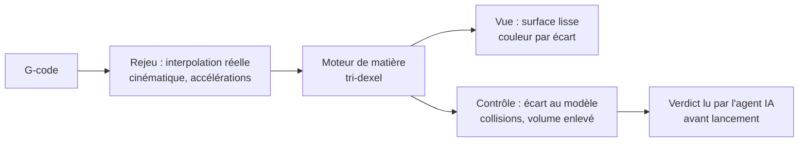

# Simulation d'usinage avec vrai enlèvement de matière — plan

*1ᵉʳ novembre 2026. Plan, rien n'est implémenté. Les chiffres de performance et de précision seront mesurés à chaque jalon.*

**But :** voir la vraie découpe dans le brut, comme dans les simulateurs de type Swansoft, et surtout pouvoir s'y fier : mesurer la pièce obtenue, la comparer au modèle et détecter les collisions avant de lancer la machine.

> **Sur la référence Swansoft.** Je n'ai pas trouvé de documentation officielle confirmant le détail de ses fonctions (enlèvement, collisions) : les sources trouvées sont secondaires ou peu fiables, et l'une ne cite que du 2 à 3 axes. La cible ci-dessous décrit donc ce qu'il nous faut, pas une copie de ce produit. [Vérifiable sur une licence d'essai.]

---

## 1. Ce qui existe aujourd'hui, et pourquoi ça ne suffit pas

Lecture de `web/three_viewer.html` et de `simulation_provider.dart` :

| Point | Constat | Conséquence |
|---|---|---|
| Rendu | Cubes instanciés, 28 voxels sur la largeur (1,4 mm pour un brut de 40 mm) | Aspect en escalier ; la surface finie n'est pas lisible |
| Forme de l'outil | Dans `cut()`, la coupe vaut un **cylindre de hauteur 2R centré sur la pointe**, pas une bille | Le fond de passe est faux |
| Balayage | `cut()` est appelé à chaque image, sur la position courante | À vitesse élevée, l'outil saute d'un point à l'autre : des passes restent non coupées |
| Position de l'outil | `currentPos.z -= 11`, valeur fixée à la main sur une maquette décorative | Le point de coupe ne découle pas du G-code au zéro pièce près |
| Géométrie | Constantes du graphe de scène non calibrées (`zAxis = 200 + m.z`…) | Le simulateur ne connaît ni le pivot, ni le G54 du programme |
| Durée | Formule approchée (`(da + dc×0,25)×0,35`), rapides à 1500 mm/min alors que la config plafonne X/Y à 500 | Temps estimé faux ; aucune accélération |
| Collisions | Seul cas : G0 qui plonge dans le brut, plus la plage de A | Ni queue d'outil, ni porte-outil, ni brides |
| Résultat | Aucun : pas de mesure, pas de comparaison au modèle | On regarde une animation, on ne vérifie rien |

Ce simulateur reste utile comme animation, pas comme preuve.

---

## 2. Le principe : séparer le calcul de l'image

**Le même rejeu sert à tout.** `pipeline/verify5.py` rejoue déjà le G-code par cinématique directe, avec le bon pivot et les bons plafonds d'axes. La simulation doit s'y brancher : une seule vérité sur « où est l'outil », et non une deuxième cinématique dans le JavaScript.

**Le modèle de matière retenu : le tri-dexel.** Le brut est décrit par des segments de matière le long de trois familles de droites parallèles à X, Y et Z.

- Il gère les flancs raides et les contre-dépouilles, ce qu'une simple carte de hauteur ne sait pas faire. En 5 axes, c'est éliminatoire pour la carte de hauteur.
- La mémoire reste raisonnable : on ne stocke que les bords de matière, pas tout le volume.
- C'est la méthode employée par des logiciels commerciaux récents ([MecSoft CAM 2026](https://mecsoft.com/blog/whats-new-in-mecsoft-cam-2026/), avec accélération GPU) et par des travaux en temps réel sur le 5 axes ([Springer](https://link.springer.com/article/10.1007/s00170-023-10950-z)).

| Option écartée | Pourquoi |
|---|---|
| Voxels plus fins | La mémoire croît au cube : passer de 1,4 à 0,1 mm multiplie par ~2 700 |
| Opérations booléennes sur maillage (CSG) | Précises mais trop lentes sur des dizaines de milliers de blocs, et fragiles numériquement |
| Carte de hauteur seule | Fausse dès que la pièce bascule |

**Où calculer :** dans le navigateur embarqué, en JavaScript avec des tableaux typés, dans un Web Worker. C'est le seul endroit commun au téléphone et au PC, sans serveur. WebGPU n'est pas retenu au départ : sa disponibilité dans WebView2 et les WebView Android reste à vérifier. Il reste une accélération possible en jalon S6.

---

## 3. Jalons

Chaque jalon apporte quelque chose d'utilisable seul.

| # | Contenu | Preuve de fin de jalon |
|---|---|---|
| **S0** | **Rejeu commun** : le programme devient une liste d'échantillons (position, A, C, temps), produite par le pipeline ou un port Dart de `verify5`, puis envoyée au visualiseur. Fin du `z -= 11` et des constantes décoratives | Pointe d'outil à moins de 0,01 mm du rejeu Python sur `test/fixtures/dome5_continu.nc` |
| | **S0 fait le 1ᵉʳ nov.** Durées et cinématique communes à `verify5` et à l'app (`gcode_replay.dart`, écart de durée < 0,5 s). Scène 3D calée sur le G54 et le pivot du programme : écart à la pointe du rejeu Python < 0,000001 mm sur 50 blocs contrôlés dans le navigateur. Le rendu reste en cubes, la vraie forme d'outil et le balayage sont S1. | |
| **S1** | **Vraie coupe 3 axes** : tri-dexel, fraise boule et plate, balayage entre deux points. Rendu par maillage extrait | Volume enlevé sur une poche connue : écart < 1 %. Aucune passe manquante à vitesse × 100 |
| | **S1 fait le 1ᵉʳ nov.** Moteur `web/js/dexel_stock.js`, testé par `node test/js/dexel_stock_test.js` : poche à 0,1 % du volume attendu, bille et fraise plate, maillage fermé. Chaque bloc est coupé en entier : 0,06 % d'écart entre un rejeu bloc par bloc et des sauts de 50 blocs. Non mesuré sur téléphone. La forme de l'outil vient de l'en-tête du programme : plate si « BOULE » n'y figure pas. | |
| **S2** | **5 axes** : balayage avec A et C dans le repère pièce, découpé assez fin pour que la corde reste sur la pièce | Dôme : écart simulé / théorique sous la résolution de la grille |
| **S3** | **Écart au modèle** : carte de couleur reste / manque / pénétration ; le modèle vient du STEP ou STL | Défaut volontaire de 0,5 mm retrouvé au bon endroit |
| **S4** | **Collisions et montage proposés par l'agent** (§5, décision 3) : queue, porte-outil, table, brides. L'agent déduit du STEP ce qu'il faut, propose, et l'opérateur confirme ce qui est réellement monté | Bride placée sur le trajet détectée, avec numéro de ligne. Sans confirmation, l'écran affiche « non contrôlé » |
| **S5** | **Temps réel de la machine** : accélérations de la config, planificateur type grbl | Durée simulée à ± 15 % de la durée mesurée (cible du `PLAN-OPTIMISATION` §5) |
| **S6** | **Confort** : avance/retour, coupe en section, pied à coulisse virtuel, export du brut final en STL | Brut final réutilisable comme entrée de l'opération suivante |

**Ordre conseillé :** S0, S1, S2, S3. Tant que S0 n'est pas fait, le reste construirait une belle image sur une position fausse. S4 passe devant S3 si des essais avec brides approchent.

---

## 4. Risques

| Risque | Parade |
|---|---|
| Lenteur sur téléphone | Résolution adaptée à l'appareil et affichée. Le calcul précis peut se faire sur le PC, le téléphone n'affiche que le résultat |
| Écart entre simulation et réalité (jeu, courroies, décrochage) | Le dire à l'écran : la simulation vérifie le **programme**, pas la machine |
| Confiance excessive | Toujours afficher la résolution et ce qui n'est pas modélisé. Pas de « OK » si les brides ne sont pas déclarées, mais « non contrôlé » |
| Double cinématique | Un test compare Python, Dart et le simulateur sur le même programme |

---

## 5. Décisions

1. **Où calculer :** aperçu dans l'app (S1 à S3), rapport de contrôle précis côté pipeline, à partir de `verify5`. En cas d'écart, c'est le rapport du pipeline qui fait foi.
2. **Pas de pupitre virtuel.** Le simulateur sert à contrôler les programmes, pas à former à un pupitre.
3. **Outil et montage choisis par l'agent selon le STEP, en dialogue avec l'utilisateur.**
   - **L'agent déduit du STEP :** diamètre d'outil selon les plus petits rayons concaves, sortie d'outil selon la profondeur à atteindre, dimensions du brut, zones de bridage possibles.
   - **Le calcul reste déterministe :** ces valeurs viennent d'une analyse de la géométrie, testée. L'agent présente le résultat et l'explique, il ne l'invente pas. Il reprend aussi les chiffres du rapport, par exemple la part de surface hors de portée.
   - **Il demande ce que le STEP ne peut pas dire :** les fraises et porte-outils réellement disponibles, leurs cotes, les brides posées. Un STEP décrit la pièce, pas l'atelier.
   - **Avant le lancement :** l'opérateur confirme ce qui est monté. Sans cette confirmation, la collision reste « non contrôlée ». Le porte-outil actuel (rayon 12, longueur 40 mm) est une supposition, signalée comme telle tant qu'il n'est pas confirmé.
